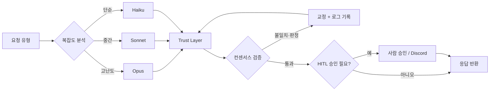

<div align="center">

# 🌿 mint-agent

**운영 중인 YouTube 자동화를 _플랫폼 무관 엔진 + 교체 가능한 어댑터_ 로 가르고,
그 위에 검증·HITL·비용 라우팅 _신뢰 레이어(trust layer)_ 를 얹는다.**

<sub>A platform-agnostic multi-agent automation engine + trust layer, carved out of a YouTube
pipeline running in production since April 2026. *The platform is an adapter; the engine is the asset.*</sub>

[](https://github.com/minjun91a/mint-agent/actions/workflows/ci.yml)


[아키텍처](#-아키텍처) · [빠른 시작](#-빠른-시작) · [개발 블로그](docs/blog/) · [로드맵](docs/roadmap.md) · [ADR](docs/adr/)

</div>

---

## mint-agent란?

운영 중인 YouTube 콘텐츠 자동화(2026-04~)를 **플랫폼 무관 엔진(`core/`) + 교체 가능한
어댑터(`adapters/`)** 로 가르는 중인 프로젝트다. 엔진은 모델 호출·검증·발행 게이트를 *플랫폼을
모른 채* 담고, 플랫폼별 로직은 어댑터에 격리한다. 최종 목표는 여기에 **신뢰 레이어**(복잡도 기반
비용 라우팅 · 검증 · HITL · 관측)를 얹어, 데모가 아니라 **운영 위에서 검증되는 시스템**을 만드는 것.

> **Phase 1(엔진/어댑터 경계 분리) 완료 · Phase 2(신뢰 레이어) 진행 중 — 특성화 테스트 301개 green.**
> 아래 "핵심 기능"은 ✅(현재 작동) / 🔜(계획) 을 정직하게 구분한다.

## 핵심 기능

- **🔌 플랫폼 무관 어댑터 구조 — ✅ 작동** · `core/`는 어댑터 구체 타입을 모른다. 발행 게이트가
  youtube가 *아닌* 가짜 어댑터에도 동작함을 테스트로 증명(adapter-agnostic).
- **🧩 모델 게이트웨이 — ✅ 작동** · Gemini·OpenAI·Claude를 같은 `complete` 포트 뒤로 통합.
  프로바이더를 늘려도 엔진/어댑터 코드는 **0줄 변경**.
- **🧭 복잡도 기반 비용 라우터 — ✅ 엔진 작동 + 라이브 경로 관측 배선** · 요청 복잡도를 추정해
  티어(Opus/Sonnet/Haiku)를 고르고, 호출마다 (모델·토큰·비용·근거)를 계측한다. 라우터 자신이
  게이트웨이 포트를 구현해 **드롭인**이라, 조립점(`core/gateway.py`)에서 어댑터·엔진의 모든
  게이트웨이를 감싸 라이브 호출을 계측한다(명시 모델은 안 덮음 = 동작 불변). **비용 정직성**:
  단가표에 있는 모델만 비용 계상, 미확보 프로바이더(Gemini/OpenAI)는 미가격(None)으로 남긴다 —
  *지어내지 않는다.* 실단가·실측 usage 연동은 Phase 2 잔여.
- **🛡️ 발행 전 Trust 게이트 + HITL 정책 — ✅ 룰 기반 작동** · `approve`만 통과, `review`·`reject`는
  사람 보류. AI 라벨·금지표현·전문가 자문 영역 검사.
- **🧪 특성화 테스트 + 원본 parity — ✅ 301 green** · 운영 코드를 안 깨고 이식했음을 테스트로 보증.
- **📊 멀티모델 컨센서스 검증 · 관측성 로깅 — 🔜 Phase 2** · 응답을 여러 모델로 교차 검증해
  환각을 잡고 교정·기록하는 것이 목표. 검증 규칙은 매일의 코드 검증 훈련([daily-drill](https://github.com/minjun91a/daily-drill))에서
  반복 발견한 *"그럴듯하지만 틀린"* 패턴을 코드화해 채운다 — 현재 3일차(SQL·pandas·Python), 규칙 후보 축적 중.
- **💬 Discord IO 경계 분리 — ✅ 채널 정체성 분리** · 채널→역할 매핑을 `adapters/discord/`로 분리
  (의존 방향 IO→콘텐츠), youtube 어댑터는 Discord를 모른다. *봇 런타임(discord_bot·notifier·approvals)
  이식은 🔜 별도 IO 어댑터 작업.*

## 🏗 아키텍처



> **목표 아키텍처(비전).** **복잡도 기반 라우팅(Opus/Sonnet/Haiku)은 엔진 레벨로 구현됨**
> (`core/routing.py` — 아래 [라우터 예제](#-빠른-시작)). 컨센서스 검증·Discord HITL 실배선은
> Phase 2/1 후반 예정 — 현재 구현 상태는 위 **핵심 기능**(✅/🔜)·아래 **로드맵** 참조.

## 🚀 빠른 시작

```bash
# 1. 클론
git clone https://github.com/minjun91a/mint-agent.git
cd mint-agent

# 2. 테스트 실행에 필요한 최소 의존성 (외부 SDK 불필요 — 주입 설계)
pip install -r requirements-dev.txt

# 3. 특성화 테스트 (이식 동일성 보증) — 301 green, CI에서도 동일 실행
python -m pytest
```

> 전체 파이프라인(실 LLM·이미지·업로드) 실행에는 프로바이더 SDK(`openai`·`google-generativeai`·
> `replicate`·`pillow`·`imageio-ffmpeg` 등)가 **호출 시점에 지연 로드**되며 API 키가 필요하다
> (`.env`: `GEMINI_API_KEY` / `OPENAI_API_KEY` / `REPLICATE_API_TOKEN` …).

### 최소 예제 — 엔진이 어댑터를 포트로 구동한다 (키 불필요)

```python
from core.pipeline import gate
from adapters.youtube.adapter import YouTubeAdapter

# 엔진은 어댑터 구체 타입을 모른다 — PlatformAdapter 포트로만 다룬다.
adapter = YouTubeAdapter(review_deep=False)   # 룰 기반 컴플라이언스 게이트 (오프라인)

script = {"title": "The Murim Genius", "body": "A young martial artist levels up."}
seo = {"title": "K-Webtoon Short", "description": "Epic short. AI-generated assets used."}

decision = gate(adapter, script, seo)
print(decision.proceed)                 # True  → 발행 진행
print(decision.verdict.recommendation)  # "approve" | "review" | "reject"
```

> `description`에서 AI 라벨(예: "AI-generated")을 빼면 게이트가 `review`로 바뀌어
> `proceed=False`(HITL 보류)가 된다 — **Trust ②(사람 승인)를 엔진 레벨에서 강제**한다.

### 복잡도 비용 라우터 — 쉬운 일에 비싼 모델을 쓰지 않는다 (키 불필요)

```python
from core.routing import CostRouter, aggregate

records = []
# CostRouter는 LLMGateway를 구현 → 어떤 게이트웨이든 감싸는 드롭인.
router = CostRouter(any_gateway, sink=records.append)   # any_gateway: Gemini/OpenAI/Claude…

# model="auto"면 복잡도로 티어를 고른다 (호출 없이 미리보기).
print(router.route_for("", "이 문단을 요약해줘", model="auto")[0])           # → Haiku (저렴)
print(router.route_for("", "이 아키텍처를 분석·리팩터해줘", model="auto")[0])  # → Opus  (고성능)

# 실제 호출은 감싼 게이트웨이에 위임되고, 매 호출이 비용까지 계측된다.
router.complete("", "요약해줘", model="auto")
print(aggregate(records))   # {'calls': 1, 'cost_usd': ..., 'by_tier': {'cheap': {...}}}
```

> 라우터 자신이 `LLMGateway` 포트라, 어댑터는 `GeminiGateway`를 쓰는지 `CostRouter(GeminiGateway())`를
> 쓰는지 **모른 채** 동일하게 동작한다 — 라우팅·비용 계측이 코드 변경 0줄로 들어온다.

## 📂 프로젝트 구조

```text
mint-agent/
├── core/                   # 플랫폼 무관 엔진
│   ├── llm.py              # 모델 게이트웨이 (Gemini · OpenAI · Claude 프로바이더)
│   ├── routing.py          # 복잡도 비용 라우터 (LLMGateway 데코레이터 + 계측)
│   ├── gateway.py          # 게이트웨이 조립점 + 관측 배선 (default_gemini/openai)
│   ├── pipeline.py         # PlatformAdapter 포트 + 발행 게이트 gate()
│   ├── control.py  persona.py  orchestrator.py   # 라우팅·페르소나·브리핑 메커니즘
│   ├── memory.py           # 채널 메모리 (경로 주입)
│   └── trust/verify.py     # 검증 어휘 (Verdict · Violation · Reviewer)
├── adapters/
│   ├── youtube/            # produce · review · publish 구현 + 도메인 어휘 (콘텐츠)
│   │   ├── story_writer.py  seo.py  image_gen.py  captions.py  tts_engine.py
│   │   ├── video_builder.py  thumbnail_gen.py  clip_extractor.py
│   │   └── publish.py  review.py  adapter.py  control.py  persona.py  orchestrator.py
│   └── discord/            # Discord IO 경계 (채널 정체성 → 페르소나 라우팅)
├── docs/                   # roadmap · inventory · ADR · 개발 블로그
├── tests/                  # 301 characterization tests
├── pyproject.toml
└── LICENSE                 # MIT
```

## 🗺 로드맵

- [x] **Phase 0** — 정리·결정·git 안전망·엔진/어댑터 인벤토리
- [x] **Phase 1 — 완료 ✅** · 엔진/어댑터 경계 분리: `review`·`produce` 전 단계(story_writer·seo·
  image_gen·captions·clip_extractor·tts·video·thumbnail)·`publish` 이식 + 모델 게이트웨이(Gemini·OpenAI·Claude) +
  엔진 control(라우터+dispatch)/persona/orchestrator + `YouTubeAdapter`·발행 게이트 + **2중 결합 분해**(Discord IO를
  `adapters/discord/`로, youtube는 콘텐츠 전용). 엔진은 플랫폼을 모른 채 포트로만 의존 — 테스트로 증명
- [ ] **Phase 2 — 진행 중 🔄** · 신뢰 레이어 1차: 복잡도 기반 비용 라우터(Opus/Sonnet/Haiku) **✅ 엔진 구현 + 관측 배선** ·
  *남음: 실단가·auto 라우팅·실측 usage 연동 · eval 하니스 · 컨센서스 검증 · 관측성 대시*
- [ ] **Phase 3** — 2번째 어댑터(research/digest): RAG + pgvector, **엔진 변경 0으로 어댑터 추가** = 추상화 증명
- [ ] **Phase 4** — 채용용 마감: 아키텍처 다이어그램 · 실측 지표 · 데모

전체 진행 추적 → [docs/roadmap.md](docs/roadmap.md) · 결정 기록 → [docs/adr/](docs/adr/) · 빌드 과정 → [docs/blog/](docs/blog/)

## 📜 License

MIT

---

<div align="center"><sub>개발자(민준)의 AI/백엔드 포트폴리오 — 빌드 과정을 커밋·ADR·블로그로 공개 기록한다.</sub></div>
