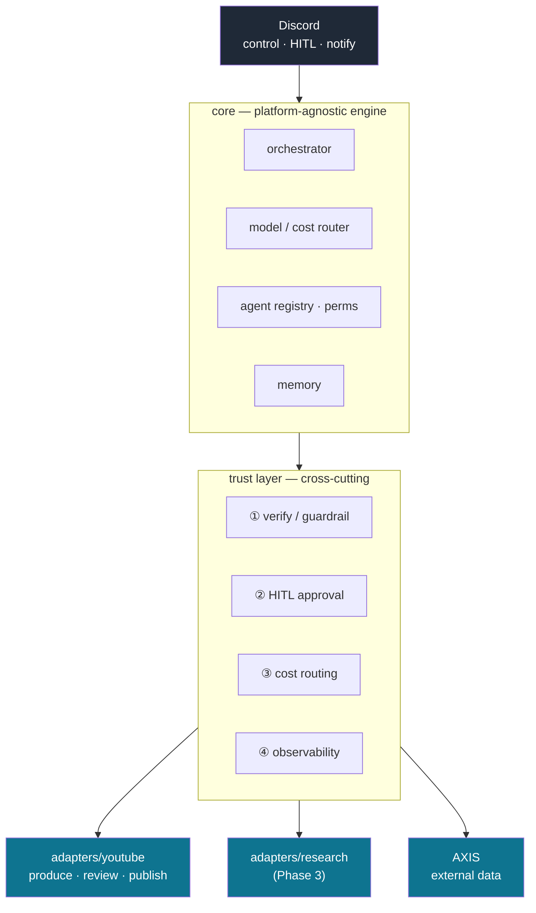

# mint-agent

> **플랫폼 독립 멀티 에이전트 자동화 엔진 + 신뢰(Trust) 레이어.**
> 데모가 아니라, **2026년 4월부터 운영 중인 YouTube 자동화 파이프라인 위에서 검증**한다.

> **mint-agent** — A platform-agnostic multi-agent automation engine with a built-in **trust layer**
> (verification · human-in-the-loop · cost routing · observability), proven on a YouTube content
> pipeline running in production since April 2026. The platform is an *adapter*; the engine is the asset.

---

## 왜 (Why)

AI에게 일을 자동으로 맡기면 세 가지가 문제다 — **환각**(없는 사실을 지어냄), **비용 예측 불가**,
**관측 불가**(무엇을 했는지 안 보임). mint-agent는 자동화 엔진에 이 셋을 감시·통제하는
**신뢰 레이어**를 결합한다.

- 자동화만 → "콘텐츠 팜"으로 읽히는 데모.
- 신뢰 레이어만 → 사용자 0명짜리 데모웨어.
- **결합 → 실트래픽 위에서 검증된 신뢰 레이어** = 프로덕션에서 버티는 관측 가능·비용 통제 시스템.

## 아키텍처 (Architecture)

> 결합면은 셋이다 — **Discord**(제어·승인·알림) · **YouTube**(콘텐츠 출구) · **AXIS**(외부 비즈니스 데이터).
> 상세 분류는 [docs/inventory.md](docs/inventory.md).

## 신뢰 레이어 4기둥 (Trust Pillars)

| # | 기둥 | 하는 일 | 현 구현 |
|---|---|---|---|
| ① | **검증/가드레일** | 발행 *전* 환각·정책 위반 차단 (AI 라벨·저작권·EU AI Act 등) | `compliance` 게이트 ✅ |
| ② | **HITL 승인** | 위험·애매한 건 Discord 버튼으로 사람 승인 | `approvals` + Discord ✅ |
| ③ | **비용 라우팅** | 복잡도별 모델 선택(Opus/Sonnet/Haiku) · 비용 계측 | 비용 계측 ✅ · 중앙 라우터 Phase 2 |
| ④ | **관측성** | 요청별 동작·비용·지연·오류 구조화 로깅 | 파이프라인 알림 ✅ · 지표화 Phase 2 |

## 측정 지표 (Metrics) — *정의됨, 값은 측정 예정*

> 정직 원칙: 측정하지 않은 수치는 적지 않는다. Phase 2 eval 하니스에서 채운다.

| 지표 | 정의 | 현재 |
|---|---|---|
| 환각 차단율 | 발행 전 게이트가 잡은 사실오류/위반 비율 | 🔜 Phase 2 |
| 영상당 비용 | 1편 생성 LLM+API 비용(USD) | 🔜 Phase 2 |
| 비용 라우팅 절감 | 복잡도 라우팅 전후 비용차 | 🔜 Phase 2 |
| p95 파이프라인 지연 | produce→publish 소요(s) | 🔜 Phase 2 |
| HITL 개입율 | 자동 통과 vs 사람 승인 비율 | 🔜 Phase 2 |

**현재까지 검증된 운영 사실(🟢):** 2026-04 운영 시작 · 어댑터 코드 26개 모듈(`agents/`) +
11개 파이프라인/CLI(`tools/`) + 6개 Discord(`bot/`) · 컴플라이언스 감사 로그 26개(jsonl) ·
멀티 프로바이더(Claude · Gemini · OpenAI · ElevenLabs · FLUX/DALL-E).

## 기술 스택 (Stack)

- **언어/런타임:** Python 3.14 (LLM·네트워크 호출 async 지향)
- **LLM:** Anthropic Claude(도구사용 에이전트) · Google Gemini · OpenAI
- **미디어:** ElevenLabs TTS · FLUX/DALL-E 이미지 · ffmpeg 합성
- **제어/HITL:** Discord(봇 + REST) · SQLite(승인·메모리)
- **벡터 DB(계획):** pgvector (Phase 3 research 어댑터)
- **외부 API:** YouTube Data/Analytics v3

## 현재 상태 / 로드맵 (Status)

**Phase 0(정리·결정) 완료.** 운영 코드는 youtube-agent에서 검증됨, 모노레포 이관은 Phase 1.
전체 진행 → [docs/roadmap.md](docs/roadmap.md)

| Phase | 내용 | 상태 |
|---|---|---|
| 0 | 정리·결정·분류·안전망 | ✅ 완료 |
| 1 | 엔진/어댑터 경계 분리 + 동작 동일성 테스트 | ⏭️ 다음 |
| 2 | 신뢰 레이어 1차 (eval·관측성·비용 라우터·가드레일) | ⬜ |
| 3 | 2번째 어댑터 research/digest (RAG + pgvector) | ⬜ |
| 4 | 채용용 마감 (아키텍처·지표·데모) | ⬜ |

## 문서 (Docs)

- [docs/inventory.md](docs/inventory.md) — 엔진/어댑터/Trust 전수 분류
- [docs/roadmap.md](docs/roadmap.md) — Phase 진행 추적
- [docs/adr/](docs/adr/) — 아키텍처 의사결정 기록(ADR)
- [docs/blog/](docs/blog/) — 개발기
- [docs/agent-persona.md](docs/agent-persona.md) — 이 repo의 에이전트 페르소나(MINT) 정의·재사용법

---

*이 repo는 개발자(민준)의 AI/백엔드 포트폴리오로, 빌드 과정을 공개 기록한다.*
