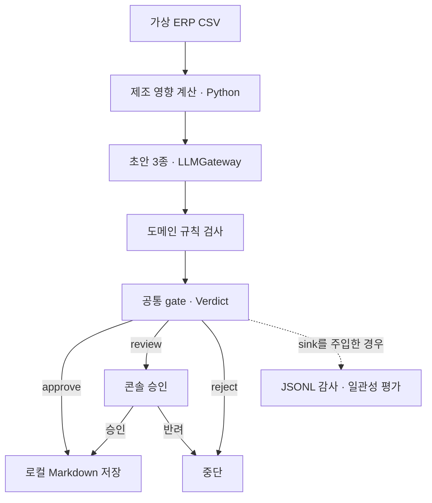

# 🌿 mint-agent

**AI 업무 자동화의 생성·검증·사람 승인·발행을 분리한 Python 엔진입니다.**

대표 시나리오는 제조 업무입니다. 출하일이 바뀌면 자재 부족분을 코드로 계산하고,
LLM이 문서 초안 3종을 작성한 뒤 규칙 검사와 필요한 사람 승인을 거쳐 Markdown으로 저장합니다.

[](https://github.com/minjun91a/mint-agent/actions/workflows/ci.yml)


[빠른 시작](#빠른-시작) · [제조 시나리오](#대표-시나리오-출하일-변경) · [구현 범위](#현재-구현-범위) · [마감 우선순위](docs/portfolio-roadmap.md)

## 해결하려는 문제

AI가 업무 문장을 생성할 수 있어도, 없는 자재코드를 쓰거나 내부 정보를 고객 회신에 담으면
그대로 발행해서는 안 됩니다. 계산·생성·검증·발행을 나누면 어떤 판단을 코드가 맡고,
어디에서 사람이 검토해야 하는지 추적할 수 있습니다.

기존 YouTube 자동화에서 공통 로직을 분리하며 시작했고, research와 manufacturing 어댑터로
다른 업무에도 같은 계약을 적용했습니다. 현재 대표 실행 경로는 제조 CLI이며,
실제 ERP에 연결하거나 고객에게 이메일을 보내는 서비스는 아닙니다.

## 빠른 시작

Python 3.12 이상이 필요합니다. CI는 3.12·3.13·3.14에서 테스트합니다.
아래 데모는 API 키와 모델 호출 없이 동작하며, 제조 초안과 사람의 응답을 시뮬레이션합니다.

### Windows PowerShell

```powershell
git clone https://github.com/minjun91a/mint-agent.git
cd mint-agent
python -m venv .venv
./.venv/Scripts/python.exe -m pip install -r requirements-dev.txt
./.venv/Scripts/python.exe demo.py manufacturing
```

### macOS / Linux

```bash
git clone https://github.com/minjun91a/mint-agent.git
cd mint-agent
python3 -m venv .venv
.venv/bin/python -m pip install -r requirements-dev.txt
.venv/bin/python demo.py manufacturing
```

전체 데모는 `demo.py`를 인자 없이 실행합니다.
`gate`, `citation`, `routing`, `consensus`, `audit`, `manufacturing`을 골라 실행할 수도 있습니다.
감사 데모는 임시 디렉터리의 JSONL을 읽어 리포트를 만들고,
제조 데모는 실제 콘솔 입력을 기다리지 않습니다.

## 대표 시나리오: 출하일 변경

포함된 CSV 5개는 가상 제조 데이터입니다. 고객사A의 P-100 출하일을
2026-08-31에서 2026-08-28로 앞당기는 고정 예제로 재현합니다.

| 단계 | 처리 | 확인할 코드 |
|---|---|---|
| 영향 계산 | 미완성 생산량과 BOM·입고일을 대조해 M-01 부족분 440개 계산 | [analyze.py](adapters/manufacturing/analyze.py) |
| 초안 생성 | 내부 조정안·협력업체 요청·고객 회신을 각각 생성 | [draft.py](adapters/manufacturing/draft.py) |
| 규칙 검사 | 초안 누락·없는 코드·명시적 수량/날짜 불일치·일부 내부 정보 노출 검사 | [review.py](adapters/manufacturing/review.py) |
| 사람 승인 | `review`인 경우만 승인 또는 반려 요청 | [approval.py](core/approval.py) |
| 결과 저장 | 일회성 허가와 내용 일치를 확인한 뒤 로컬 Markdown으로 저장 | [publish.py](adapters/manufacturing/publish.py) |

오프라인 데모에서 확인할 결과는 다음과 같습니다.

- 없는 코드가 들어간 초안 → `reject`.
- 자재·항목에 연결된 수량/날짜가 근거와 다름 → `reject`. 연결이 불명확한 숫자는 `review`.
- 고객 회신에 내부 자재코드·협력업체명이 포함된 초안 → `review`.
- 사람이 승인하면 `publish=True`, 반려하면 `publish=False`.
- 자재 입고 지연을 입력하는 보조 시나리오에서는 M-04가 400개 부족해집니다.

이 결과는 [데모 테스트](tests/test_demo.py)로 확인합니다.
`demo.py manufacturing`은 계산·검증·승인 분기를 보여주며,
실제 LLM 초안 생성과 파일 저장까지 실행하는 명령은 아래 CLI입니다.

### 실제 LLM을 사용하는 제조 CLI

현재 구현은 `google.generativeai` SDK와 기본 모델 `gemini-2.5-flash`를 사용합니다.
키와 모델 이용 권한이 필요하고, 실행하면 초안 3종에 대한 유료 API 호출이 발생할 수 있습니다.
SDK·모델의 현재 가용성과 최신 단가는 별도로 확인해야 합니다.

PowerShell에서 위 가상환경을 만든 뒤 실행합니다.

```powershell
./.venv/Scripts/python.exe -m pip install google-generativeai
$env:GEMINI_API_KEY = Read-Host "Gemini API 키"
./.venv/Scripts/python.exe run_manufacturing.py --out-dir output/manufacturing
Remove-Item Env:GEMINI_API_KEY
```

키는 현재 터미널의 환경변수로 전달합니다. 이 진입점은 `.env` 파일을 자동으로 읽지 않습니다.
`review`가 나오면 콘솔의 `y/N` 입력을 기다립니다.
저장은 로컬 파일 발행이며 외부 전송은 없습니다.

키가 없으면 초안 3종이 `draft_missing`으로 거절되고 파일은 생성되지 않습니다.
이 정책상 거절도 종료 코드는 0이므로, 성공 여부는 `확정 발행` 또는 `발행하지 않음` 출력으로 구분합니다.

## 아키텍처와 설계 판단



- **계산은 코드, 서술은 모델:** 수량 산식을 LLM에 맡기지 않습니다. 다만 생성 문장이
  계산 결과를 정확히 옮겼는지는 별도 검사합니다. 명시적 수량·날짜를 대상/항목과 함께 대조하고,
  해석할 수 없는 숫자는 사람이 검토합니다. 문장 전체의 의미를 이해하는 검사는 아닙니다.
- **공유하는 것은 계약:** 어댑터는 `produce / review / publish`를 구현하고,
  검증 결과를 `Verdict`로 반환합니다. 도메인 규칙은 어댑터에 둡니다.
- **거절과 보류를 구분:** `reject`는 중단하고 `review`만 사람에게 묻습니다.
  제조 publisher가 승인한 내용의 일회성 허가를 발급하며, `publish()`는 허가 없는 호출과
  내용 변경·재사용을 거절합니다. 콘솔에서는 사람이 판단하기 전에 전체 초안을 보여줍니다.
- **외부 경계 주입:** 모델·저장 위치·승인 콜백을 바꿀 수 있어 실제 API 없이 경로를 검증합니다.
- **로그 저장은 명시적 설정:** 감사 sink와 비용 observer는 선택 기능입니다.
  기본 제조 CLI에는 영속 감사·비용 로그 저장이 연결되어 있지 않습니다.

## 현재 구현 범위

| 영역 | 구현된 것 | 남은 경계 |
|---|---|---|
| manufacturing | 양방향 영향 계산, 명시적 수량/날짜 검사, 콘솔 승인, 내용에 묶인 일회성 발행 허가 | 가상 CSV 기반. 실제 ERP 연동·문장 전체의 의미 검증 없음 |
| research | 검색·본문 수집·요약·인용 검사·다이제스트 발행, 선택적 RAG | 사용자가 바로 실행할 전용 CLI 없음. 실제 pgvector 왕복 미검증 |
| YouTube | 생성·검토·발행 모듈과 업로드 백엔드 주입 | 기존 운영 시스템의 봇 런타임·전체 실행 진입점 미이식 |
| Discord | 채널·페르소나 연결 경계 | 승인 버튼 UI·봇 런타임 미이식 |
| 비용·관측 | 프로바이더별 라우팅, usage/근사 토큰 구분, 비용·감사 리포트 | 자동 라우팅은 `model="auto"` 선택 시만. OpenAI auto 라우트는 비어 있음 |

제조 검사는 **빈 초안·코드·명시적 수량/날짜·일부 정보 노출에 대한 규칙 검사**입니다.
답변 전체의 사실 정확도나 모든 환각을 보장하지 않습니다.
research의 인용 ID 검사도 인용 본문이 주장을 뒷받침한다는 보장과 구분합니다.
컨센서스·감사 로그의 내부 일관성 평가 역시 정답 라벨을 둔 품질 평가를 대체하지 않습니다.
지원하는 표현과 승인 API는 [제조 검증·승인 설명](docs/manufacturing-validation.md)에 있습니다.

## 검증 근거

- 기준 코드 `6854ee4`의 [2026-08-26 CI](https://github.com/minjun91a/mint-agent/actions/runs/32934313753)에서
  Python 3.12·3.13·3.14 작업이 성공했습니다. Python 3.13 로그에서 **730 passed**를 확인할 수 있습니다.
- [제조 CLI 테스트](tests/test_run_manufacturing.py)는 가짜 게이트웨이로 승인→저장,
  사람 승인/반려, 키 없음→저장 없음 경로를 검증합니다.
- 외부 API 호출은 테스트 대역으로 대체합니다. 실제 제공자의 응답 품질·지연·운영 안정성은
  이 CI 결과에 포함되지 않습니다.
- 과거 비용표는 **2026-07-10 기준 단가**입니다. 문서의 약 18배 차이는 같은 토큰 수의 단가 비교이며,
  품질을 유지한 실제 업무 비용 절감률로 측정한 결과는 아닙니다.

전체 테스트 실행:

```powershell
./.venv/Scripts/python.exe -m pytest
```

macOS/Linux에서는 `.venv/bin/python -m pytest`를 사용합니다.
측정 명령과 과거 결함 수정 기록은 [metrics.md](docs/metrics.md)에 있습니다.

## 취업용 마감 순서

1. **현재 상태 전달:** README와 실제 코드의 차이를 정리하고 실행·검증·미구현 범위를 명시합니다.
2. **핵심 경로 이해와 정확성 보완:** 본인의 코드 이해 리뷰를 재개하고, 추가한 수량·날짜 검사와 발행 승인 경계를 확인합니다.
3. **품질 평가와 실행 재현:** 고정 평가셋, 실패 경로, 실제 모델 실행 기록과 관측 로그를 준비합니다.
4. **포트폴리오 설명:** 검증이 끝난 범위로 시연·설계 판단·본인 기여·이력서 문장을 정리합니다.

작업별 근거와 완료 조건은 [취업용 마감 계획](docs/portfolio-roadmap.md)에 정리했습니다.
새 어댑터나 UI 확장은 핵심 경로 마감 이후로 미룹니다.

## 문서와 배경

최민준의 AI 서비스·에이전트 개발 포트폴리오입니다.
기존 운영 코드의 분리·이식과 AI 보조 개발 과정은 커밋·ADR·리뷰 기록으로 남겨 두었습니다.
[리뷰 계획](docs/review-roadmap.md)에 따라 본인이 설명할 수 있는 범위를 확인하며 마감합니다.

- [취업용 마감 계획](docs/portfolio-roadmap.md): 현재 우선순위와 완료 조건
- [개발 로드맵](docs/roadmap.md): Phase별 개발 이력
- [설계 결정 ADR](docs/adr/): 구조를 선택한 이유
- [개발 블로그](docs/blog/): 분리·이식·검증 과정
- [실측 지표](docs/metrics.md): 측정 시점과 명령, 알려진 한계
- [MIT License](LICENSE)

