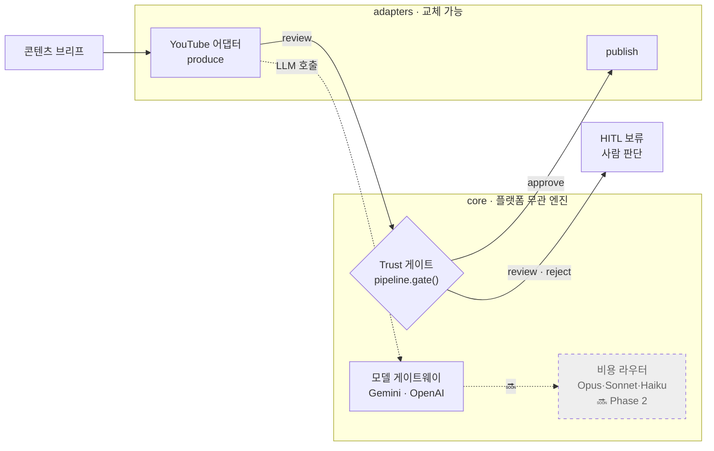

<div align="center">

# 🌿 mint-agent

**운영 중인 YouTube 자동화를 _플랫폼 무관 엔진 + 교체 가능한 어댑터_ 로 가르고,
그 위에 검증·HITL·비용 라우팅 _신뢰 레이어(trust layer)_ 를 얹는다.**

<sub>A platform-agnostic multi-agent automation engine + trust layer, carved out of a YouTube
pipeline running in production since April 2026. *The platform is an adapter; the engine is the asset.*</sub>

[](https://github.com/minjun91a/MINT/actions/workflows/ci.yml)


[아키텍처](#-아키텍처) · [빠른 시작](#-빠른-시작) · [개발 블로그](docs/blog/) · [로드맵](docs/roadmap.md) · [ADR](docs/adr/)

</div>

---

## mint-agent란?

운영 중인 YouTube 콘텐츠 자동화(2026-04~)를 **플랫폼 무관 엔진(`core/`) + 교체 가능한
어댑터(`adapters/`)** 로 가르는 중인 프로젝트다. 엔진은 모델 호출·검증·발행 게이트를 *플랫폼을
모른 채* 담고, 플랫폼별 로직은 어댑터에 격리한다. 최종 목표는 여기에 **신뢰 레이어**(복잡도 기반
비용 라우팅 · 검증 · HITL · 관측)를 얹어, 데모가 아니라 **운영 위에서 검증되는 시스템**을 만드는 것.

> **현재 Phase 1(엔진/어댑터 경계 분리) 진행 중 — 특성화 테스트 143개 green.**
> 아래 "핵심 기능"은 ✅(현재 작동) / 🔜(계획) 을 정직하게 구분한다.

## 핵심 기능

- **🔌 플랫폼 무관 어댑터 구조 — ✅ 작동** · `core/`는 어댑터 구체 타입을 모른다. 발행 게이트가
  youtube가 *아닌* 가짜 어댑터에도 동작함을 테스트로 증명(adapter-agnostic).
- **🧩 모델 게이트웨이 — ✅ 작동** · Gemini·OpenAI를 같은 `complete` 포트 뒤로 통합. 프로바이더를
  늘려도 엔진/어댑터 코드는 **0줄 변경**.
- **🛡️ 발행 전 Trust 게이트 + HITL 정책 — ✅ 룰 기반 작동** · `approve`만 통과, `review`·`reject`는
  사람 보류. AI 라벨·금지표현·전문가 자문 영역 검사.
- **🧪 특성화 테스트 + 원본 parity — ✅ 143 green** · 운영 코드를 안 깨고 이식했음을 테스트로 보증.
- **🧭 복잡도 기반 비용 라우터 — 🔜 Phase 2** · 게이트웨이 seam 위에 Opus/Sonnet/Haiku 라우팅.
- **📊 멀티모델 컨센서스 검증 · 관측성 로깅 — 🔜 Phase 2**
- **💬 Discord HITL 어댑터 — 🔜 Phase 1 후반** · 레거시에서 작동 중, 모노레포 이관 예정.

## 🏗 아키텍처



> 핵심: **엔진은 어댑터 구체 타입을 모른다.** `gate()`는 `PlatformAdapter` 포트만 받으므로,
> youtube가 아닌 어떤 어댑터든 끼울 수 있다. 결합면 상세 분류는 [docs/inventory.md](docs/inventory.md).

## 🚀 빠른 시작

```bash
# 1. 클론
git clone https://github.com/minjun91a/MINT.git
cd MINT

# 2. 테스트 실행에 필요한 최소 의존성 (외부 SDK 불필요 — 주입 설계)
pip install -r requirements-dev.txt

# 3. 특성화 테스트 (이식 동일성 보증) — 143 green, CI에서도 동일 실행
python -m pytest
```

> 전체 파이프라인(실 LLM·이미지·업로드) 실행에는 프로바이더 SDK(`openai`·`google-generativeai`·
> `replicate`·`pillow`·`imageio-ffmpeg` 등)가 **호출 시점에 지연 로드**되며 API 키가 필요하다
> (`.env`: `GEMINI_API_KEY` / `OPENAI_API_KEY` / `REPLICATE_API_TOKEN` …).

### 최소 예제 — 엔진이 어댑터를 포트로 구동한다 (키 불필요)

```python
from core.pipeline import gate
from adapters.youtube.adapter import YouTubeAdapter

# 엔진은 어댑터 구체 타입을 모른다 — PlatformAdapter 포트로만 다룬다.
adapter = YouTubeAdapter(review_deep=False)   # 룰 기반 컴플라이언스 게이트 (오프라인)

script = {"title": "The Murim Genius", "body": "A young martial artist levels up."}
seo = {"title": "K-Webtoon Short", "description": "Epic short. AI-generated assets used."}

decision = gate(adapter, script, seo)
print(decision.proceed)                 # True  → 발행 진행
print(decision.verdict.recommendation)  # "approve" | "review" | "reject"
```

> `description`에서 AI 라벨(예: "AI-generated")을 빼면 게이트가 `review`로 바뀌어
> `proceed=False`(HITL 보류)가 된다 — **Trust ②(사람 승인)를 엔진 레벨에서 강제**한다.

## 📂 프로젝트 구조

```text
mint-agent/
├── core/                   # 플랫폼 무관 엔진
│   ├── llm.py              # 모델 게이트웨이 (Gemini · OpenAI 프로바이더)
│   ├── pipeline.py         # PlatformAdapter 포트 + 발행 게이트 gate()
│   ├── memory.py           # 채널 메모리 (경로 주입)
│   └── trust/verify.py     # 검증 어휘 (Verdict · Violation · Reviewer)
├── adapters/
│   └── youtube/            # produce · review · publish 구현
│       ├── story_writer.py  seo.py  image_gen.py  captions.py
│       └── clip_extractor.py  publish.py  review.py  adapter.py
├── docs/                   # roadmap · inventory · ADR · 개발 블로그
├── tests/                  # 143 characterization tests
├── pyproject.toml
└── LICENSE                 # MIT
```

## 🗺 로드맵

- [x] **Phase 0** — 정리·결정·git 안전망·엔진/어댑터 인벤토리
- [ ] **Phase 1 — 진행 중 🔄** · 엔진/어댑터 경계 분리: `review`·`produce`(story_writer·seo·
  image_gen·captions·clip_extractor)·`publish` 이식 + 모델 게이트웨이(Gemini·OpenAI) +
  `YouTubeAdapter`·발행 게이트 · *남음: tts·video·thumbnail, 엔진 persona/control/orchestrator, Discord 어댑터*
- [ ] **Phase 2** — 신뢰 레이어 1차: 복잡도 기반 비용 라우터(Opus/Sonnet/Haiku) · eval 하니스 · 관측성
- [ ] **Phase 3** — 2번째 어댑터(research/digest): RAG + pgvector, **엔진 변경 0으로 어댑터 추가** = 추상화 증명
- [ ] **Phase 4** — 채용용 마감: 아키텍처 다이어그램 · 실측 지표 · 데모

전체 진행 추적 → [docs/roadmap.md](docs/roadmap.md) · 결정 기록 → [docs/adr/](docs/adr/) · 빌드 과정 → [docs/blog/](docs/blog/)

## 📜 License

MIT

---

<div align="center"><sub>개발자(민준)의 AI/백엔드 포트폴리오 — 빌드 과정을 커밋·ADR·블로그로 공개 기록한다.</sub></div>
